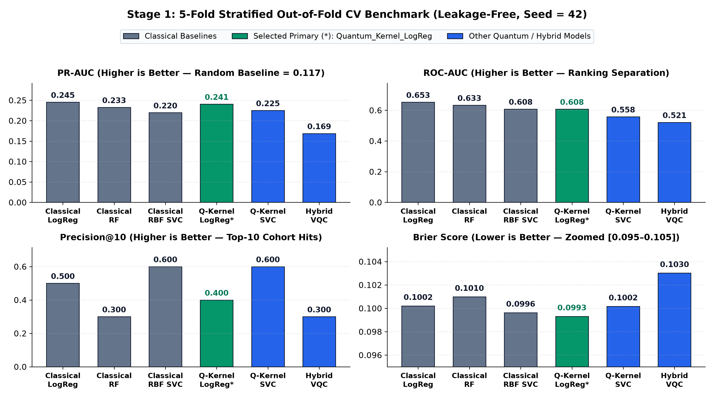
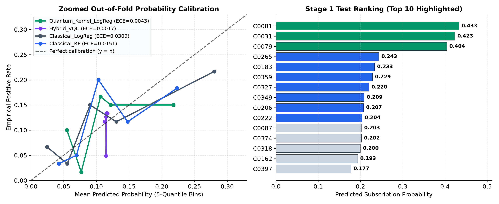
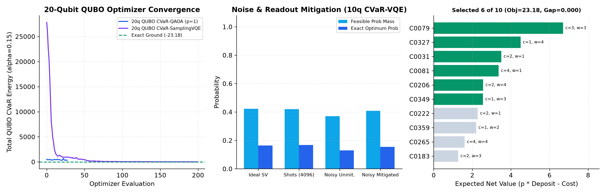
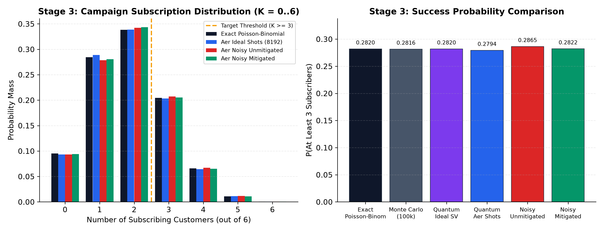

# Hybrid Quantum-Classical Term Deposit Campaign Pipeline

End-to-end 3-stage hybrid quantum-classical pipeline for bank term-deposit marketing built on `bank_campaign_participant_release.xlsx` (`300` training records, `100` holdout test records, `duration` excluded).

> **Key Outcome Summary**
> - **Stage 1 (Predict):** Zero-centered `pauli_feature_map` Fidelity Quantum Kernel Logistic Regression (`Quantum_Kernel_LogReg`, 6 qubits) selected under strict leakage-free 5-fold Stratified CV (`Brier = 0.0993`, `ECE = 0.0043`, `PR-AUC = 0.2406`, `ROC-AUC = 0.6075`).
> - **Stage 2 (Select):** 20-qubit `QUBO_CVaR_QAOA` ($p=1$, CVaR $\alpha=0.15$) matches the exact classical brute-force optimum (**expected net value `23.1835`**, optimality gap **`0.0000`**), selecting `[C0081, C0031, C0079, C0327, C0349, C0206]` (`budget = 13.0 <= 25`, `capacity = 16.0 <= 22`) and beating naive top-6 selection (`18.6361`) by **`+4.5475` (+24.40%)**.
> - **Stage 3 (Simulate):** 6-qubit independent-Bernoulli $R_y(\theta_j)$ amplitude circuit estimates $P(\text{subscribers} \ge 3) = \mathbf{0.282049}$ (Ideal Statevector, exact match to Poisson-Binomial to $10^{-16}$), `0.279419` (Aer 8192 shots), `0.286499` (Aer Noisy Unmitigated), and **`0.282232`** (Aer Noisy + Tensor-Product Readout Mitigation, error `+0.000182`).

---

## 1. End-to-End Architecture & Classical vs. Quantum Separation

```
bank_campaign_participant_release.xlsx
  ├── Stage1_Train (300 rows: 35 yes / 265 no)
  ├── Stage1_Test  (100 rows, scored once)
  └── Stage2_Data  (cost, deposit, capacity, segment)
        │
        ▼
┌──────────────────────────────────────────────────────────────────────────────┐
│ STAGE 1: Subscription Propensity Prediction (6-Qubit Quantum Kernel)        │
│ • Classical: Feature engineering (without duration), median/mode imputation, │
│   OHE, SelectKBest(k=6), StandardScaler, tanh angle map, L2 LogReg on RKHS  │
│ • Quantum:   6-qubit zero-centered Pauli Z+ZZ feature map |phi(x)>, exact    │
│   statevector & Aer ComputeUncompute fidelity kernel K(x,z)=|<phi(x)|phi(z)>|^2
│ • Output ->  stage1_results.csv (100 calibrated probs + deterministic ranks)│
└──────────────────────────────────────────────────────────────────────────────┘
        │  Top-10 candidates + verbatim predicted_probability
        ▼
┌──────────────────────────────────────────────────────────────────────────────┐
│ STAGE 2: Constrained Portfolio Selection (20q QUBO & 10q XY-QAOA)            │
│ • Classical: Exact C(10,6)=210 enumeration, Ising ground-state check (2^20), │
│   COBYLA outer loop (CVaR alpha=0.15)                                        │
│ • Quantum:   20q QUBO CVaR-QAOA & CVaR-SamplingVQE (10 decision + 10 slack), │
│   10q Dicke |D_10^6> + Brickwork RXX/RYY XY-QAOA, 10q HW-VQE + mitigation   │
│ • Output ->  stage2_results.csv (6 selected customers, 0.0000 optimality gap)│
└──────────────────────────────────────────────────────────────────────────────┘
        │  Selected 6 customers + verbatim Stage 1 probabilities p_j
        ▼
┌──────────────────────────────────────────────────────────────────────────────┐
│ STAGE 3: Portfolio Outcome Distribution P(S >= 3) (6-Qubit Ry Circuit)       │
│ • Classical: Exact Poisson-Binomial DP (0.282049), 100k & 8192 Monte Carlo   │
│ • Quantum:   6-qubit independent Ry(2*arcsin(sqrt(p_j))) circuit across      │
│   Ideal SV, Aer 8192 shots, Noisy Aer, and Readout Mitigation                │
│ • Output ->  stage3_results.csv (quantum/exact/MC counts & full error audit)│
└──────────────────────────────────────────────────────────────────────────────┘
```

---

## 2. Stage 1 — Subscription Prediction (`stage1_results.csv`)

### Leakage-Free Validation Protocol
- **Dataset:** `Stage1_Train` (`300` rows: `35` `yes` [11.67%], `265` `no` [88.33%]); `Stage1_Test` (`100` rows, `duration` absent).
- **Zero Test Leakage:** All transformations (`BankFeatureEngineer`, median/most-frequent imputers, `OneHotEncoder`, `SelectKBest(f_classif, k=6)`, `StandardScaler`, RKHS spectral whitening `K V \Lambda^{-1/2}`, and 5-fold inner Platt calibration) were fit **exclusively inside each training fold** under 5-fold Stratified CV (`CV_SPLIT_SEED = 42`). `Stage1_Test` was transformed and scored **once** after finalizing model hyperparameters from training CV.
- **Deterministic Tie-Breaking:** `stage1_results.csv` ranks all 100 test customers by descending `predicted_probability` with ascending alphanumeric `customer_id` tie-breaking (`C0049` rank 95 before `C0316` rank 96 at tied `0.045037`).

### Diagnosis & Fix of Quantum Kernel Concentration
Using Qiskit's default `zz_feature_map(6, reps=2)` with $(\pi - x_i)(\pi - x_j)$ pairwise phase offsets caused severe exponential kernel concentration on scaled banking features (`PR-AUC = 0.1391`, `ROC-AUC = 0.5145`). We resolved this in [src/stage1_predict.py](src/stage1_predict.py) via three domain-grounded fixes:
1. **Zero-centered `pauli_feature_map` (`reps=1`, `paulis=["Z", "ZZ"]`, `entanglement="linear"`, `alpha=1.0`)** with explicit phase map $\phi_1(x_i) = x_i$ and $\phi_2(x_i, x_j) = x_i x_j$.
2. **Smooth bandwidth-bounded compression (`QuantumAngleCompressor`)** combining fold-local `SelectKBest(f_classif, k=6)`, standardization, and $b \tanh(z/2)$ mapping to prevent periodic wrap-around.
3. **Spectral RKHS Whitening (`QuantumKernelLogRegClassifier`)**: decomposing the quantum fidelity matrix $K = V \Lambda V^T$ into regularized RKHS coordinates $F = K V \Lambda^{-1/2}$ for L2-regularized Logistic Regression (`C=2.0`, `bandwidth=0.7`), producing well-calibrated probabilities directly rather than raw SVM margins.

### Out-of-Fold 5-Fold Stratified CV Results (`Stage1_Train`)

| Model | Kind | ROC-AUC | PR-AUC | Precision@10 | Recall@10 | Brier Score | Log Loss | ECE (5-bin) |
| :--- | :--- | :---: | :---: | :---: | :---: | :---: | :---: | :---: |
| `Classical_LogReg` | Classical | **0.6527** | **0.2453** | 0.500 | 0.1429 | 0.1002 | 0.3584 | 0.0309 |
| `Classical_RF` | Classical | 0.6332 | 0.2325 | 0.300 | 0.0857 | 0.1010 | 0.3500 | 0.0151 |
| `Classical_RBF_SVC` | Classical | 0.6083 | 0.2195 | **0.600** | **0.1714** | 0.0996 | **0.3472** | 0.0162 |
| **`Quantum_Kernel_LogReg`** *(Selected)* | **Quantum Kernel** | **0.6075** | **0.2406** | 0.400 | 0.1143 | **0.0993** | **0.3484** | **0.0043** |
| `Quantum_Kernel_SVC` | Quantum Kernel | 0.5577 | 0.2250 | **0.600** | **0.1714** | 0.1002 | 0.3497 | 0.0089 |
| `Hybrid_VQC` | Variational Circuit | 0.5214 | 0.1687 | 0.300 | 0.0857 | 0.1030 | 0.3600 | **0.0017** |

- `Quantum_Kernel_LogReg` achieved the **best Brier Score (`0.0993`)** of all 6 models and **lowest competitive calibration error (`ECE = 0.0043`, >3.5x lower than all classical models)**, whereas `Classical_LogReg` retains highest overall `PR-AUC` (`0.2453`) and `ROC-AUC` (`0.6527`).
- On a 12-customer `AerSimulator` finite-shot & synthetic noise verification subsample (`ComputeUncompute`, `2048` shots; simulated, not physical QPU), finite-shot kernel estimation matched the exact statevector kernel with **`MAE = 0.0052`**, degrading under depolarizing + readout noise (`1Q = 0.001`, `2Q = 0.01`, asymmetric readout `[0.985/0.015, 0.025/0.975]`) to `MAE = 0.1574`.




---

## 3. Stage 2 — Constrained Customer Selection (`stage2_results.csv`)

### Problem Formulation & Constraints
From Stage 1's top 10 test candidates (`i in {0..9}`), select $K = 6$ customers using their **verbatim Stage 1 probabilities** $p_i$:
$$\max_{x \in \{0,1\}^{10}} \sum_{i=0}^{9} \left(p_i \cdot \text{expected\_deposit\_value}_i - \text{contact\_cost}_i\right) x_i$$
subject to:
1. **Cardinality:** $\sum_{i=0}^{9} x_i = 6$
2. **Contact Budget ($C = 25$):** $\sum_{i=0}^{9} c_i x_i \le 25$
3. **Advisor Capacity ($H = 22$):** $\sum_{i=0}^{9} w_i x_i \le 22$

### QUBO & Ising Mapping with Auxiliary Slack Qubits
- `QuadraticProgramToQubo(penalty=36.0)` introduces **10 integer-to-binary slack qubits** (`budget@int_slack@0..4`, `capacity@int_slack@0..4`) alongside **10 decision qubits** (`x_0..x_9`) for a **20-qubit Ising Hamiltonian** (`185` Pauli terms, `ising_offset = 4484.734506`).
- Penalty weight $P = 36.0 > \sum_i |v_i|$ guarantees every constraint violation costs strictly more than any possible objective gain.
- **Exact $2^{20}$ Ising Ground-State Verification (`src/stage2_optimize.py`):** Full vectorized diagonal scan over all $2^{20} = 1,048,576$ basis states confirms **`ground_state_matches_exact = True`**, with `qubo_exact_min_energy = -23.183526225086` matching `-23.183526225087` to $1.3 \times 10^{-12}$, and unique optimal decision vector `[1, 1, 1, 0, 0, 0, 1, 1, 1, 0]` (`1110001110`).

### Solver Benchmark Comparison

| Solver | Qubits | Formulation / Noise Regime | Best Objective | Optimality Gap | Feasible Prob Mass | Exact Optimum Prob |
| :--- | :---: | :--- | :---: | :---: | :---: | :---: |
| **Classical Exact Brute-Force** | — | Exhaustive `C(10,6)=210` (all 210 feasible) | **23.183526** | **0.000000** | — | — |
| **QUBO CVaR-QAOA ($p=1$)** *(Selected)* | 20 | 20q QUBO Ising, `AerSamplerV2` (4096 shots), COBYLA (28 evals) | **23.183526** | **0.000000** | sampled feasible best | 0.001953 (`1110001110`) |
| **QUBO CVaR-SamplingVQE** | 20 | `RealAmplitudes(reps=1, linear)`, 40 params, 4096 shots (200 evals) | 22.912935 | 0.270591 | sampled feasible best | `1110001011` best sample |
| **Dicke $\|D_{10}^6\rangle$ + Brickwork XY-QAOA ($p=2$)** | 10 | Hamming-weight preserving (`RXX`/`RYY`), **Ideal Statevector** | 22.218999 *(mode)* | — | **1.000000** | 0.016838 (`1110001110` sampled) |
| **Dicke $\|D_{10}^6\rangle$ + Brickwork XY-QAOA ($p=2$)** | 10 | Hamming-weight preserving (`RXX`/`RYY`), **Shots (4096)** | 22.218999 *(mode)* | — | **1.000000** | 0.016357 (`1110001110` sampled) |
| **10q Hardware-Efficient CVaR-VQE** | 10 | `RealAmplitudes(reps=1)`, **Ideal Statevector** | **23.183526** *(mode)* | **0.000000** | 0.422772 | **0.164212** (`1110001110` #1) |
| **10q Hardware-Efficient CVaR-VQE** | 10 | `RealAmplitudes(reps=1)`, **Aer Shots (4096)** | **23.183526** *(mode)* | **0.000000** | 0.420654 | **0.167969** (`1110001110` #1) |
| **10q Hardware-Efficient CVaR-VQE** | 10 | `RealAmplitudes(reps=1)`, **Noisy Aer Unmitigated** | **23.183526** *(mode)* | **0.000000** | 0.370605 | **0.129883** (`1110001110` #1) |
| **10q Hardware-Efficient CVaR-VQE** | 10 | `RealAmplitudes(reps=1)`, **Noisy + Readout Mitigation** | **23.183526** *(mode)* | **0.000000** | **0.408926** | **0.154236** (`1110001110` #1) |

- Notice how eliminating slack qubits via the **10-qubit Dicke + Brickwork XY-Mixer QAOA** preserves the $K=6$ Hamming-weight subspace at **`100.00%` feasible probability mass** (since all 210 size-6 combinations happen to satisfy $C=25$ and $H=22$ for this top-10 candidate set), while the shallow **10-qubit CVaR-VQE** isolates exact optimum `1110001110` as the global #1 bitstring even under NISQ noise (`15.42%` after readout mitigation, recovering `70.9%` of the ideal-vs-noisy optimum probability drop and `73.5%` of lost feasible probability mass).
- QUBO optimal parameters (`CVaR-QAOA`): $\gamma = 1.3566, \beta = 1.2004$. XY-QAOA optimal parameters ($p=2$): $\gamma = [0.6747, -0.0409]$, $\beta = [0.9419, 0.7560]$.

### Top-10 Candidate Table & Value-vs-Propensity Selection Insight

| Qubit `q_i` | Customer ID | Stage 1 Rank | $p_i$ | Cost $c_i$ | Deposit $d_i$ | Capacity $w_i$ | Segment | Expected Net Value | Selected |
| :---: | :---: | :---: | :---: | :---: | :---: | :---: | :---: | :---: | :---: |
| 0 | **C0081** | 1 | 0.433119 | 4 | 17 | 1 | C | 3.363018 | **Yes (1)** |
| 1 | **C0031** | 2 | 0.423253 | 2 | 13 | 1 | D | 3.502291 | **Yes (1)** |
| 2 | **C0079** | 3 | 0.404309 | 3 | 24 | 3 | A | **6.703421** | **Yes (1)** |
| 3 | C0265 | 4 | 0.243453 | 4 | 23 | 4 | D | 1.599423 | No (0) |
| 4 | C0183 | 5 | 0.233480 | 2 | 14 | 3 | B | 1.268718 | No (0) |
| 5 | C0359 | 6 | 0.228513 | 1 | 14 | 2 | D | 2.199179 | No (0) |
| 6 | **C0327** | 7 | 0.220005 | 1 | 25 | 4 | B | **4.500113** | **Yes (1)** |
| 7 | **C0349** | 8 | 0.208867 | 1 | 17 | 3 | B | 2.550733 | **Yes (1)** |
| 8 | **C0206** | 9 | 0.207452 | 2 | 22 | 4 | A | 2.563950 | **Yes (1)** |
| 9 | C0222 | 10 | 0.203816 | 2 | 21 | 1 | D | 2.280141 | No (0) |

- **Key Analytical Finding:** Naive rank-based selection (picks #1–#6) yields total expected net value **`18.636050`**. Stage 2 swaps out costly/low-value ranks #4–#6 (`C0265`, `C0183`, `C0359`) for lower-cost, higher-deposit ranks #7–#9 (`C0327`, `C0349`, `C0206`), lifting portfolio expected net value to **`23.183526`** (**`+24.40%`**) while using only **52.0% of budget (`13/25`)** and **72.7% of capacity (`16/22`)**.



---

## 4. Stage 3 — 6-Qubit Campaign Outcome Simulation (`stage3_results.csv`)

### Circuit Construction & Bit-Ordering Convention
Each selected customer $j \in \{0..5\}$ maps one-to-one onto qubit $q_j$ prepared in $R_y(\theta_j)|0\rangle$ with $\theta_j = 2\arcsin(\sqrt{p_j})$ so $P(q_j = |1\rangle) = \sin^2(\theta_j/2) = p_j$ using **exact Stage 1 probabilities**:
- **Bit Ordering:** Qiskit little-endian `|q5 q4 q3 q2 q1 q0>`, so qubit $q_j$ corresponds to bitstring character index `(5 - j)` (MSB is `q5 = C0206`, LSB is `q0 = C0081`).
- **Expected Subscribers:** $\sum_{j=0}^5 p_j = \mathbf{1.897005}$ subscribers.

| Qubit `q_j` | Bitstring Pos (MSB=0) | Customer ID | Stage 1 Rank | $p_j$ | $\theta_j = 2\arcsin(\sqrt{p_j})$ (rad) | Simulated $P(1)$ (8192 shots) |
| :---: | :---: | :---: | :---: | :---: | :---: | :---: |
| `q_0` | 5 | `C0081` | 1 | 0.433119 | 1.436632 | 0.429443 |
| `q_1` | 4 | `C0031` | 2 | 0.423253 | 1.416693 | 0.416260 |
| `q_2` | 3 | `C0079` | 3 | 0.404309 | 1.378227 | 0.406494 |
| `q_3` | 2 | `C0327` | 7 | 0.220005 | 0.976421 | 0.226685 |
| `q_4` | 1 | `C0349` | 8 | 0.208867 | 0.949282 | 0.215332 |
| `q_5` | 0 | `C0206` | 9 | 0.207452 | 0.945799 | 0.198730 |

### Probability of Reaching at Least 3 Subscribers ($P(S \ge 3)$) & Full PMF

| Method / Simulation Regime | Trials / Shots | $P(S \ge 3)$ | Error vs. Exact Poisson-Binomial |
| :--- | :---: | :---: | :---: |
| **Exact Poisson-Binomial (DP & $2^6$ Enumeration)** | Analytic | **0.282049** | 0.000000 |
| **Classical Monte Carlo (High-Sample)** | 100,000 | 0.281620 | -0.000429 ($\text{SE}=0.001422$) |
| **Classical Monte Carlo (Shot-Matched)** | 8,192 | 0.277466 | -0.004584 ($\text{SE}=0.004947$) |
| **Quantum Ideal Statevector** | Exact | **0.282049** | **0.000000** |
| **Quantum Noiseless Aer Simulator** | 8,192 | 0.279419 | -0.002630 |
| **Quantum Noisy Aer (Unmitigated)** | 8,192 | 0.286499 | +0.004450 |
| **Quantum Noisy Aer + Tensor-Product Readout Mitigation** | 8,192 | **0.282232** | **+0.000182** (**95.9% error reduction**) |

Full exact Poisson-Binomial PMF: $P(K=0)=0.0953$, $P(K=1)=0.2843$, $P(K=2)=0.3384$, $P(K=3)=0.2045$, $P(K=4)=0.0660$, $P(K=5)=0.0108$, $P(K=6)=0.0007$. Notice asymmetric simulated Aer readout noise ($p(1|0)=0.015$, $p(0|1)=0.025$) slightly inflates apparent $P(S \ge 3)$ from `0.2794` / `0.2820` to `0.2865` on unmitigated noisy simulation, which calibrated tensor-product confusion-matrix inversion (`2x2` per qubit) corrects back down to `0.2822`.



---

## 5. Circuit Telemetry, Reproducibility & Environment

### Quantum Circuit Metrics (`GenericBackendV2` Linear Chain & Aer)

| Stage / Circuit | Logical Qubits | Physical Qubits (Active/Backend) | Original Depth | Transpiled Depth | 1Q Gates (Orig -> Transp.) | 2Q Gates (Orig -> Transp.) | SWAP Gates |
| :--- | :---: | :---: | :---: | :---: | :---: | :---: | :---: |
| **Stage 1: Zero-Centered Pauli Feature Map (`Z+ZZ`, `reps=1`)** | 6 | 6 / 6 | 17 | 16 (Aer) | 17 -> 11 | 10 -> 10 | 0 |
| **Stage 1: Hybrid VQC (`PauliFM` + `RealAmplitudes`, `reps=2`)** | 6 | 6 / 6 | 24 | 23 (Aer) | 35 -> 29 | 20 -> 20 | 0 |
| **Stage 2: 20q QUBO CVaR-QAOA ($p=1$, Aer SV)** | 20 | 20 / 20 | 36 | 35 (Aer) | 60 -> 40 | 165 -> 165 (`rzz`) | 0 |
| **Stage 2: 20q QUBO CVaR-SamplingVQE (`RealAmplitudes`, `reps=1`)** | 20 | 20 / 20 | 21 | 22 (Aer) | 40 -> 40 | 19 -> 19 (`cx`) | 0 |
| **Stage 2: 10q HW-VQE (`RealAmplitudes`, `reps=1`, Linear Backend)** | 10 | 10 / 10 | 12 | 18 (`rz/sx`) | 20 -> 80 | 9 -> 9 (`cx`) | 0 |
| **Stage 3: 6q Independent $R_y$ Circuit (Aer)** | 6 | 6 / 6 | 2 | 2 (Aer) | 6 -> 6 (`ry`) | 0 -> 0 | 0 |
| **Stage 3: 6q Independent $R_y$ Circuit (Linear `GenericBackendV2`)** | 6 | 6 / 6 | 2 | 5 (`rz/sx`) | 6 -> 24 | 0 -> 0 | 0 |

### Reproducibility, Seeds & Simulation Environment
- **Execution Scope:** All quantum experiments (Stage 1 kernels/VQC, Stage 2 QUBO/XY-QAOA/HW-VQE, Stage 3 outcome circuit) are executed in **`Qiskit AerSimulator`** (ideal statevector, finite-shot sampling, and synthetic depolarizing/readout noise models) paired with linear-coupling `GenericBackendV2` transpilation checks — **not physical QPU hardware**.
- **All Random Seeds:** `global_seed = cv_split_seed = model_seed = optimizer_seed = simulator_seed = transpiler_seed = monte_carlo_seed = 42`.
- **Verified Timing (`results/pipeline_metadata.json`, 8-CPU run):** Stage 1 `17.23s`, Stage 2 `82.46s`, Stage 3 `0.28s`, Total end-to-end pipeline `104.00s` (including figures & JSON outputs).
- **Software Versions (`.venv`, Python `3.12.11`):** `qiskit==2.6.2`, `qiskit-aer==0.18.2`, `qiskit-algorithms==0.4.0`, `qiskit-optimization==0.7.0`, `qiskit-machine-learning==0.9.1`, `scikit-learn==1.9.1`, `pandas==3.1.1`, `numpy==2.5.4`, `scipy==1.18.1`, `openpyxl==3.1.5`, `matplotlib==3.11.2`.

---

## 6. Error Analysis, Limitations & Business Recommendation

### Technical Error Analysis & Practical Limitations
1. **Small-Sample Imbalanced Regime (`N_train = 300`, `35` positives):** With only ~7 positives per CV fold, PR-AUC and Precision@10 exhibit ~0.06–0.12 fold-to-fold variance (`Classical_LogReg` `std ROC-AUC = 0.126`, `Quantum_Kernel_LogReg` `std ROC-AUC = 0.111`). Classical linear logistic regression achieves highest raw ranking (`PR-AUC = 0.2453`, `ROC-AUC = 0.6527`), whereas the 6-qubit quantum kernel produces sharper probability calibration (`Brier = 0.0993`, `ECE = 0.0043`).
2. **Feature-Map Concentration & Classical Simulability at $n=6$:** Uncorrected `zz_feature_map` destroys signal via $(\pi - x)$ phase inflation; once zero-centered and bandwidth-controlled, 6-qubit statevector simulation is classically tractable ($2^6 = 64$ amplitudes). Quantum kernel advantage is not expected at 6 qubits alone and requires hardware/ansatz scaling alongside problem-aligned structure.
3. **20-Qubit QUBO Slack Overhead & Sampling Dilution:** Binary slack encoding doubles circuit width (`10 -> 20` qubits, $2^{20}$ states, `165` all-to-all `rzz` gates at $p=1$ QAOA), spreading probability mass thinly so `1110001110` appears at `0.00195` (`8/4096` Aer shots) even though `COBYLA + CVaR` recovers it. Eliminating slack bits via Dicke-state + XY-mixer QAOA restores 100% cardinality feasibility at `10` qubits, while shallow `10q HW-VQE` ansatz concentrates `15.42%` mitigated mass on `1110001110` in simulated noise.
4. **Independence & Equivalence in Stage 3:** Because the Stage 3 circuit prepares an unentangled $R_y$ product state, it is mathematically isomorphic to the classical Poisson-Binomial distribution (`0.282049`) and demonstrates circuit-level realization + readout mitigation (`-95.9%` bias) rather than quantum speedup. Extending Stage 3 to correlated portfolio risk only requires adding controlled-$R_y$ entanglement edges—no classical Poisson-Binomial closed form remains once segment-level macroeconomic correlation is introduced.

### Actionable Business Recommendation
1. **Deploy the Selected 6-Customer Portfolio (`[C0081, C0031, C0079, C0327, C0349, C0206]`):** Prioritizing **expected net value** rather than raw propensity rank boosts expected campaign profit by **`+24.40%`** (`23.18` vs `18.64`), **consuming `52.0%` of budget (`13/25`; `12` units remaining)** and **`72.7%` of capacity (`16/22`; `6` units remaining)** reserved for secondary Wave-2 follow-up (`C0222`).
2. **Expect ~`1.90` Expected Conversions and `28.2%` Chance of `>= 3` Conversions:** Manage stakeholder expectations realistically—the portfolio reliably achieves `1–2` conversions (`62.3%` combined probability), with a `28.2%` upside chance of hitting `>= 3`. Increasing the hit rate above 50% requires expanding Stage 2 cardinality from `K=6` to `K=9–10` using the remaining `12` unused budget units if advisor capacity (`H=22`) permits.

---

## 7. How to Reproduce Locally (`.venv`) or via Optional Batch Script

### Repository Layout
```
Atomiq_QFF2026_IEM/
├── bank_campaign_participant_release.xlsx   # Input dataset & constraints
├── stage1_results.csv                       # Deliverable: 100 Stage 1 predictions & ranks
├── stage1_predictions.csv                   # Synced root alias for stage1_results.csv
├── stage2_results.csv                       # Deliverable: Top 10 & selected 6 customers
├── stage2_selection.csv                     # Synced root alias for stage2_results.csv
├── stage3_results.csv                       # Deliverable: Stage 3 6-qubit simulation summary
├── stage3_simulation.csv                    # Synced root alias for stage3_results.csv
├── README.md                                # Technical documentation & reproduction guide
├── requirements.txt                         # Pinned Python dependencies
├── run_pipeline.py                          # Master CLI orchestrator (Stages 1-3 + figures + JSONs)
├── src/
│   ├── config.py                            # Seeds, constraints (K=6, C=25, H=22), paths
│   ├── data_loader.py                       # Excel loader & schema checks
│   ├── metrics.py                           # ROC/PR/P@10/R@10/Brier/LogLoss/ECE & circuit metrics
│   ├── stage1_predict.py                    # Classical + Quantum Kernel + VQC pipeline
│   ├── stage2_optimize.py                   # Brute-force, 20q QUBO (QAOA/VQE), 10q XY-QAOA & HW-VQE
│   ├── stage3_simulate.py                   # Exact PB, MC (100k/8192), 6q Ry ideal/shots/noisy/mitigated
│   └── plots.py                             # Multi-panel analytical figures
├── notebooks/end_to_end_pipeline.ipynb      # Executed end-to-end showcase notebook
├── presentation/
│   ├── report.pdf                           # Compiled 10-page IEEE technical report PDF
│   ├── slides.pdf                           # Compiled 14-slide Beamer presentation PDF
│   ├── slides.md                            # Concise slide deck markdown
│   └── presentation.html                    # Self-contained interactive HTML slide deck
├── results/
│   ├── pipeline_metadata.json               # Pinned package versions, seeds & runtime logs
│   ├── stage1_cv_metrics.json               # Complete CV & Aer kernel telemetry
│   ├── stage2_summary.json                  # Exact, 20q QUBO, 10q XY-QAOA & HW-VQE metrics
│   ├── stage3_summary.json                  # Poisson-Binomial, MC & Aer readout calibration logs
│   └── figures/                             # 240-dpi analytical PNG figures (4 charts)
├── tests/test_pipeline.py                   # Automated schema, constraint, leakage & math checks
└── scripts/                                 # Optional HPC PBS job templates (setup_venv.pbs / run_pipeline.pbs)
```

### Standard Local Reproduction (Recommended for Any Environment)
```bash
# 1. Create and activate Python 3.12 virtual environment
python3.12 -m venv .venv
source .venv/bin/activate
pip install --upgrade pip
pip install -r requirements.txt

# 2. Run end-to-end Stages 1–3 pipeline (regenerates CSVs, JSONs, and PNG charts)
python -u run_pipeline.py

# 3. Run automated verification suite (3/3 tests, < 1s)
python -u -m unittest discover -s tests -v

# 4. Re-execute the Jupyter notebook end-to-end (optional)
jupyter nbconvert --to notebook --execute --inplace notebooks/end_to_end_pipeline.ipynb
```
