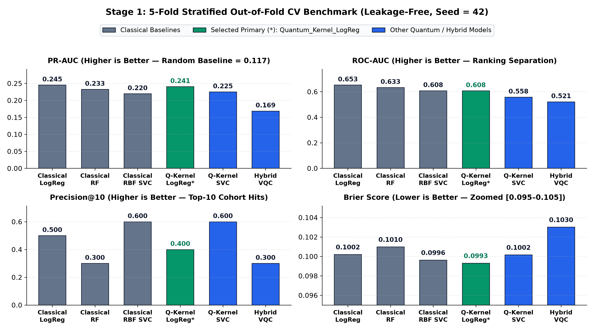
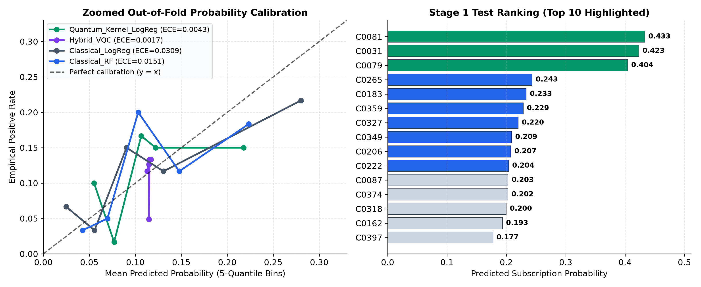
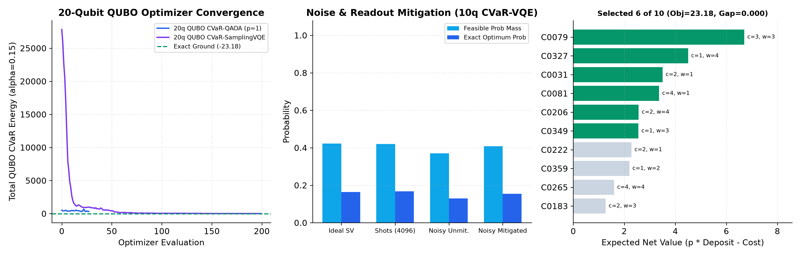
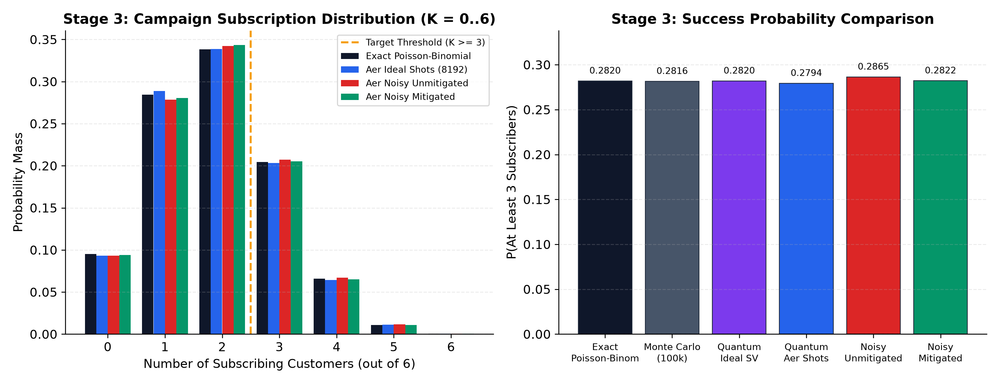

# Slide 1: Executive Overview
- **Author:** **Pradyot P. Sahoo** · Atomiq QFF 2026 IEM (`Qiskit 2.6.2`, `Qiskit Aer 0.18.2`, `Seed = 42`)
- **Stage 1 (Predict):** Zero-centered 6q `Quantum_Kernel_LogReg` -> `0.0993` Brier, `0.0043` ECE, `0.2406` PR-AUC, `0.6075` ROC-AUC.
- **Stage 2 (Select):** 20q `QUBO_CVaR_QAOA` ($p=1$) matches exact classical optimum **`23.1835`** (`gap = 0.0000`, **`+24.40%`** over rank-ordered top-6 `18.6361`), selecting `[C0081, C0031, C0079, C0327, C0349, C0206]` (`budget 13/25`, `capacity 16/22`).
- **Stage 3 (Simulate):** 6q $R_y(\theta_j)$ circuit estimates $P(S \ge 3) = \mathbf{0.282049}$ (Ideal SV = Exact DP), `0.279419` (Aer 8192 shots), `0.286499` (Noisy Aer) -> **`0.282232`** (Mitigated, **`95.9%` error cut**).

---

# Slide 2: Challenge Aim & Connected 3-Stage Architecture
- **Hackathon Objective (Challenge Specification):** Predict subscription propensity on `100` blind test rows (without post-call `duration`), pick optimal `K = 6` customers from Top-10 under `C = 25` budget & `H = 22` capacity, and forecast $P(S \ge 3)$.
- **Stage 1 -> Stage 2 -> Stage 3 Coupling:** Verbatim probabilities from `stage1_results.csv` flow unchanged into `stage2_results.csv` and `stage3_results.csv` (verified to `< 1e-12` in `tests/test_pipeline.py`).

---

# Slide 3: Stage 1 Methodology — Zero Test Leakage & Features
- **Dataset:** `Stage1_Train` (`300` customers: `35` `yes` / `265` `no`, `11.67%` base rate); `Stage1_Test` (`100` rows); `duration` purged before preprocessing.
- **Fold Isolation (`CV_SPLIT_SEED = 42`):** Domain features, median/mode imputation, OHE, `StandardScaler`, `SelectKBest(f_classif, k=6)`, RKHS whitening, and 5-fold inner Platt calibration fit **strictly inside training folds**. `Stage1_Test` is predicted once and ranked with ascending `customer_id` tie-breaks.

---

# Slide 4: Stage 1 Quantum Innovation — Solving Kernel Concentration & Aer Audit
- **Diagnosis:** Qiskit's default `zz_feature_map` introduces $(\pi - x_i)(\pi - x_j)$ phase offsets (clustering near $2\pi^2$ when $x_i \approx 0$) that collapse off-diagonal Gram entries toward noise (`PR-AUC = 0.1391`, `ROC-AUC = 0.5145`).
- **Why Zero-Centering Works:** Mapping $z \mapsto b\tanh(z/2)$ into zero-centered `pauli_feature_map(6, reps=1, paulis=['Z','ZZ'], alpha=1.0)` keeps rotation phases proportional to $x_i$ and $x_i x_j$, preserving origin symmetry & pairwise kernel similarity before RKHS whitening ($F = K V \Lambda^{-1/2}$) -> **`PR-AUC = 0.2406`**, **`ROC-AUC = 0.6075`**, **`Brier = 0.0993`**, **`ECE = 0.0043`**.
- **Aer Kernel Simulation & Noise Audit (`ComputeUncompute`, 12 customers, 2048 shots):** Finite-shot Aer matches exact statevector at **`MAE = 0.0052`**; synthetic NISQ depolarizing + readout noise raises unmitigated MAE to **`0.1574`** (Aer simulation, not physical QPU).

---

# Slide 5: Stage 1 Benchmark — Visual Comparison

- **Classical vs. Quantum Takeaway:** `Classical_LogReg` wins top ranking (**`PR-AUC = 0.2453`**, **`ROC-AUC = 0.6527`**), and `Classical_RBF_SVC` / `Quantum_Kernel_SVC` tie on `Precision@10 = 0.600`. **`Quantum_Kernel_LogReg` (Green)** is chosen as Primary for **probability calibration** (**lowest `Brier = 0.0993`**, **`ECE = 0.0043`**, `PR-AUC = 0.2406`), not ranking superiority.

---

# Slide 6: Stage 1 Calibration, Test Ranking & Complete CV Table

| Model | ROC-AUC (OOF ± std) | PR-AUC (OOF ± std) | Prec@10 | Rec@10 | Brier Score | Log Loss | ECE (5-bin) |
| :--- | :---: | :---: | :---: | :---: | :---: | :---: | :---: |
| `Classical_LogReg` | **0.6527** (±0.126) | **0.2453** (±0.058) | 0.500 | 0.1429 | 0.1002 | 0.3584 | 0.0309 |
| `Classical_RF` | 0.6332 (±0.067) | 0.2325 (±0.084) | 0.300 | 0.0857 | 0.1010 | 0.3500 | 0.0151 |
| `Classical_RBF_SVC` | 0.6083 (±0.060) | 0.2195 (±0.117) | **0.600** | **0.1714** | 0.0996 | **0.3472** | 0.0162 |
| **`Quantum_Kernel_LogReg` (Primary)** | **0.6075** (±0.111) | **0.2406** (±0.101) | 0.400 | 0.1143 | **0.0993** | 0.3484 | **0.0043** |
| `Quantum_Kernel_SVC` | 0.5577 (±0.123) | 0.2250 (±0.112) | **0.600** | **0.1714** | 0.1002 | 0.3497 | 0.0089 |
| `Hybrid_VQC` | 0.5214 (±0.159) | 0.1687 (±0.134) | 0.300 | 0.0857 | 0.1030 | 0.3600 | **0.0017** |

---

# Slide 7: Stage 2 Mathematical Formulation (Classical vs. 20q QUBO vs. 10q XY-QAOA)
- **Problem:** Maximize $\sum_{i=0}^9 (p_i d_i - c_i) x_i$ s.t. $\sum x_i = 6$, $\sum c_i x_i \le 25$, $\sum w_i x_i \le 22$.
- **Penalty QUBO vs. Dicke Subspace:** Adding 10 slack qubits + $\lambda=36.0 > \sum |v_i|$ quadratic penalties expands 20q QUBO to $2^{20}=1.05\text{M}$ states (`185` Pauli terms, exact Ising match `-23.183526`). Initializing symmetric Dicke state $|D_{10}^6\rangle$ (`210` weight-6 states) with symmetry-preserving brickwork `RXX(b)RYY(b)` ($p=2$) eliminates all slack qubits and holds **100.00% $K=6$ feasibility** (`1.68%` SV / `1.64%` shot optimum peak; $8.6\times$ vs. 20q QUBO).
- **10q `HW-VQE` (Aer Simulation):** `RealAmplitudes(reps=1)` reaches **16.42%** (SV) / **16.80%** (4k shots) / **15.42%** (mitigated noisy) optimum peak on `1110001110`.

---

# Slide 8: Stage 2 Solver Benchmark & Aer Mitigation Landscape

- `QUBO_CVaR_QAOA` (`p=1`, `20q`, `4096` Aer shots, `28` evals) recovers **`1110001110`** (`23.183526`, **`optimality_gap = 0.0000`**, `8/4096 = 0.1953%` peak).
- `QUBO_CVaR_SamplingVQE` (`20q`, `200` evals) finds #2 global solution `1110001011` (`22.912935`, `gap = 0.2706`, `5/4096 = 0.1221%`).
- `10q HW-VQE` (Feas. Mass / Opt Peak in Aer): SV `42.28% / 16.42%`, 4096 Shots `42.07% / 16.80%`, Noisy `37.06% / 12.99%`, Mitigated `40.89% / 15.42%`.

---

# Slide 9: Stage 2 Complete Top-10 Customer Portfolio (`+24.40%` Uplift)
- **Selected Cohort (`1110001110`):** `C0081` (#1, `3.3630`), `C0031` (#2, `3.5023`), `C0079` (#3, `6.7034`), **`C0327` (#7, `4.5001`)**, **`C0349` (#8, `2.5507`)**, **`C0206` (#9, `2.5639`)** -> Total **`23.1835`** (`budget = 13/25`, `capacity = 16/22`).
- **Skipped (#4–#6, #10):** `C0265` (`1.5994`), `C0183` (`1.2687`), `C0359` (`2.1992`), `C0222` (`2.2801` Wave-2 top reserve).
- Swapping ranks #4–#6 (`5.0673`) for #7–#9 (`9.6148`) creates **`+4.5475` (`+24.40%`)** net value gain over naive top-6 propensity ordering (`18.6361`).

---

# Slide 10: Stage 3 Circuit Design & Exact Poisson-Binomial Equivalence
- **Mapping (`|q5 q4 q3 q2 q1 q0> = |C0206 C0349 C0327 C0079 C0031 C0081>`, MSB0 index `5 - j`):** `q0=C0081` ($p=0.4331, \theta=1.4366$), `q1=C0031` ($0.4233, 1.4167$), `q2=C0079` ($0.4043, 1.3782$), `q3=C0327` ($0.2200, 0.9764$), `q4=C0349` ($0.2089, 0.9493$), `q5=C0206` ($0.2075, 0.9458$).
- **Circuit Scope:** $\bigotimes R_y(2\arcsin\sqrt{p_j})|0\rangle$ (`depth = 2`, `0` CNOTs); expected subscribers = **`1.8970`**; Ideal SV matches Exact Poisson-Binomial DP (`0.28204944`) to `< 1e-16`. Serves as a circuit realization & noise-mitigation benchmark (equivalent to independent Bernoulli trials, no computational speedup claimed).

---

# Slide 11: Stage 3 Aer Outcomes, Counts & Readout Mitigation

- **8,192 Aer Shot Counts (`K=0..6`):** `0: 764`, `1: 2,365`, `2: 2,774`, **`3: 1,664`**, **`4: 528`**, **`5: 92`**, **`6: 5`** -> `2,289/8,192 = 0.279419`.
- **Why Mitigation Works:** Under synthetic Aer noise, `1.5%` $0\rightarrow 1$ readout flips promote dense `K=2` states (`33.8%`) across $K \ge 3$ (`2,347/8,192 = 0.286499`); calibrating per-qubit $2\times 2$ confusion matrices $M_q$ via $|0^6\rangle, |1^6\rangle$ and inverting $\bigotimes M_q^{-1}$ yields **`0.282232` (`+0.000182`, `-95.9%` error cut)**.

---

# Slide 12: Circuit Telemetry, Determinism & Runtime Verification
- **Aer & Linear `GenericBackendV2` Transpilation:** All circuits transpile with **`0` SWAPs** (Stage 1 Pauli FM depth `16`, Stage 2 20q QAOA depth `35` / `165 rzz`, 10q HW-VQE depth `18`, Stage 3 depth `2` Aer / `5` Linear; simulator/transpilation audit, not physical QPU).
- **Determinism & Execution:** All 7 seeds = `42`; end-to-end runtime **`104.00s`** (S1 `17.23s`, S2 `82.46s`, S3 `0.28s`); `3/3` `unittest` checks & notebook execution passed cleanly.

---

# Slide 13: Evidence-Backed Verification Matrix Across Repository Deliverables
- **`stage1_results.csv` & CV (Sec 4 & 7):** `101` lines (`100` rows + header, `duration` absent), 3 classical + 3 quantum models — **Verified**.
- **`stage2_results.csv` & Optimizers (Sec 5):** `11` lines (`1110001110`, cost `13/25`, cap `16/22`, `23.183526`, `gap=0.0`), 20q QUBO (`185` Pauli) + 10q XY-QAOA (`100%` feas.) — **Verified**.
- **`stage3_results.csv` & Checks (Sec 6):** `7` lines (`8192` Aer shots), explicit MSB0 mapping, SV=`0.282049` (Exact DP), mitigated=`0.282232` — **Verified**.
- **Tests & Docs (Sec 8–9):** `tests/test_pipeline.py` (`3/3` pass, `<1e-12` coupling), `run_pipeline.py`, `end_to_end_pipeline.ipynb`, `README.md`, `report.pdf`, `slides.pdf` — **Verified**.

---

# Slide 14: Error Analysis, Limitations & Executive Recommendation
- **Scope & Limitations:** Simulation-only execution (`AerSimulator` + `GenericBackendV2`, not physical QPU); `Classical_LogReg` wins Stage 1 ranking (`PR-AUC 0.2453`), quantum kernel wins calibration (`ECE=0.0043`); Stage 3 `6q` circuit equals Poisson-Binomial DP (extendable with `CRy` correlation gates).
- **Recommendation:** Deploy Cohort **`1110001110`** (`C0081, C0031, C0079, C0327, C0349, C0206`) for **`23.1835` net value (`+24.40%` uplift)**, expect **`1.90` conversions** (`28.2%` chance of `>= 3`), consuming `52%` budget (`13/25`; `12` left) and `72.7%` capacity (`16/22`; `6` left) for Wave-2 (`C0222`).
- **Author:** **Pradyot P. Sahoo** · `github.com/pradyotqc/Atomiq_QFF2026_IEM`
